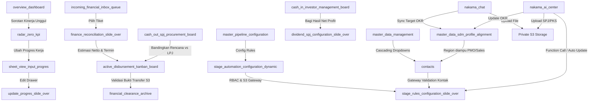
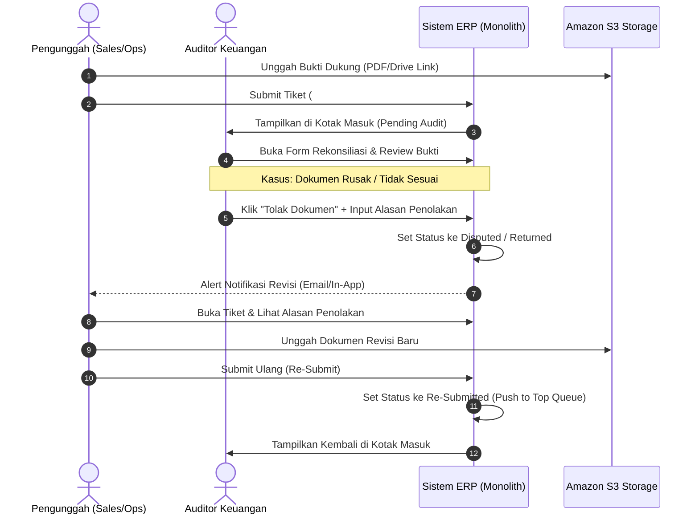

# Product Requirement Document (PRD)

## Project: Nakama Dashboard

---

## 1. Pendahuluan & Latar Belakang Proyek

**Nakama Dashboard** adalah platform perusahaan terpadu (_Enterprise Suite_) berdensitas data tinggi yang menggabungkan berbagai domain utama organisasi guna memperkuat _Data Governance_ (Tata Kelola Data) dan mengeliminasi silo komunikasi di PT Ide Bangsa Mahardika (SmartID):

1. **Executive Performance Hub**: Sistem pemantauan kinerja strategis (BI), manajemen OKR/KPI Karyawan (SmartNakama), sistem rekognisi bakat unggul (_High-Performance Spotlight_), dan otomasi alur kerja operasional antar-departemen.
2. **Finance & Ops Module**: Sistem pelacak transaksi keuangan terintegrasi, mulai dari masuknya kesepakatan penjualan (_sales deal intake_), rekonsiliasi pajak & HPP, pembayaran kas (_disbursements_), kontrol pengeluaran operasional (SPJ/Procurement), manajemen modal investor, hingga pengarsipan laporan keuangan akhir yang terkunci (_tamper-proof financial archive_).
3. **Nakama Chat**: Pusat komunikasi real-time berbasis paket `munafio/chatify` yang didesain kasual dan fleksibel untuk koordinasi kerja sekaligus meningkatkan kedekatan tim (_team bonding_).
4. **Nakama AI Center**: Pusat kendali asisten operasional berbasis _first-party_ **Laravel 13.x AI SDK** untuk eksekusi perintah otomatis, audit forensik, dan pembaruan progres kerja harian menggunakan _natural language_.

Aplikasi ini akan dibangun sebagai satu kesatuan monolitik menggunakan framework **Laravel 11 & Laravel Filament v3** sebagai fondasi utama antarmuka untuk menyediakan satu panel kendali utama (_Single Source of Truth_) bagi Executive Leadership, Manajer Keuangan, dan Operasional untuk menjaga transparansi, kepatuhan, dan efisiensi anggaran secara real-time. Seluruh antarmuka pengguna akan memanfaatkan fitur-fitur native Laravel Filament v3 (Resources, Pages, Widgets, Actions, Relation Managers, dan Infolists) untuk menjamin konsistensi visual dan kecepatan pengembangan.

---

## 2. Struktur Modul & Pemetaan Folder Workspace

Berdasarkan analisis terhadap folder representative di dalam workspace `/Users/developer/Downloads/stitch_smartdashboard_executive_performance_hub`, berikut adalah pemetaan lengkap komponen sistem ke dalam modul-modul Filament v3:

| Bidang Fungsional                     | Folder Workspace                         | Deskripsi / Peran Layar                                                                                                                     | Filament v3 Component                                                                                          |
| :------------------------------------ | :--------------------------------------- | :------------------------------------------------------------------------------------------------------------------------------------------ | :------------------------------------------------------------------------------------------------------------- |
| **Executive BI & Analytics**          | `overview_dashboard`                     | Dasbor Ringkasan Eksekutif (Revenue, Avg KPI, Efficiency, Sorotan Talenta).                                                                 | Filament Custom Dashboard & Widgets                                                                            |
|                                       | `radar_zero_kpi`                         | (_Pivoted_) Sistem rekognisi karyawan berkinerja tinggi (High-Achievers) dan alur apresiasi.                                                | Filament Custom Page & Action Buttons                                                                          |
| **Operational & OKR Tracking**        | `sheet_view_input_progres`               | Grid input data progres harian dalam tampilan spreadsheet.                                                                                  | Filament Resource with Custom Tabular/Grid View                                                                |
|                                       | `update_progres_slide_over`              | Laci samping (_slide-over_) untuk mengubah rincian progres kerja karyawan.                                                                  | Filament Slide-Over Drawer Action Form                                                                         |
|                                       | `project_kanban_operational_board`       | Papan kerja (Kanban) untuk alur tugas tim operasional.                                                                                      | Filament Custom Page with Kanban View Integration                                                              |
|                                       | `kanban_view_pipeline`                   | Papan kerja untuk pelacakan pipa prospek penjualan (Sales Pipeline).                                                                        | Filament Custom Page with Kanban View Integration                                                              |
|                                       | `okr_configuration_slide_over`           | Pengaturan target OKR, bobot, dan metrik penilaian.                                                                                         | Filament Slide-Over Relation Manager                                                                           |
| **Pipeline & Rules Engine**           | `master_pipeline_configuration`          | Konfigurasi global alur kerja (stages) untuk masing-masing departemen.                                                                      | Filament Resource (PipelineResource)                                                                           |
|                                       | `master_pipeline_config_multi_dept`      | Pengelolaan stage multi-departemen (Sales, Ops, Finance, HR).                                                                               | Filament Resource Pages & Custom Forms                                                                         |
|                                       | `master_pipeline_multi_process_view`     | Visualisasi alur proses multi-dimensi secara terintegrasi.                                                                                  | Filament Custom Dashboard Widget                                                                               |
|                                       | `stage_automation_configuration_dynamic` | Mesin otomasi transisi stage (_IF-THIS-THEN-THAT_) berbasis peran (RBAC).                                                                   | Filament Form Schema with Builder/Repeater Component                                                           |
|                                       | `stage_rules_configuration_slide_over`   | Konfigurasi validasi file di S3 dan otorisasi eksekusi status stage.                                                                        | Filament Slide-Over Drawer Action Form                                                                         |
| **HR & Master Data**                  | `master_struktur_organisasi`             | Pohon struktur organisasi divisi dan tim.                                                                                                   | Filament Custom Page with Org-Tree Component                                                                   |
|                                       | `master_data_management`                 | Database utama untuk kontak entitas (Klien Pemerintah, Swasta, Instruktur) dan master data wilayah (Region, Provinsi, Kabupaten/Kota, OPD). | Filament Resources (`ContactResource`, `RegionResource`, `ProvinceResource`, `RegencyResource`, `OpdResource`) |
|                                       | `tambah_edit_data_master_slide_over`     | Form manajemen entitas baru dan data katalog wilayah/kontak.                                                                                | Filament Slide-Over Drawer Action Form                                                                         |
|                                       | `master_data_sdm_profile_alignment`      | Profil karyawan (SmartNakama), perataan data SDM (_alignment_), target OKR, penugasan region diampu untuk PMO/Sales, dan pipeline tambahan. | Filament Resource (`EmployeeResource`)                                                                         |
| **Finance (Intake & Reconciliation)** | `incoming_financial_inbox_queue`         | Antrean terpusat untuk tiket masuk (Intake) yang butuh audit.                                                                               | Filament Resource (FinanceIntakeResource)                                                                      |
|                                       | `buka_tiket_form_rekonsiliasi_keuangan`  | Alur pengajuan & kalkulasi tiket finansial baru.                                                                                            | Filament Action Form Modal                                                                                     |
|                                       | `finance_reconciliation_slide_over`      | Laci kalkulasi bruto/netto, komponen pajak (PPh 21/23/PPN), dan honor.                                                                      | Filament Slide-Over Action Wizard Form                                                                         |
| **Finance (Cash Flow Control)**       | `active_disbursement_kanban_board`       | Pelacakan kas keluar dan termin penagihan (Accounts Receivable).                                                                            | Filament Custom Page with Kanban View Integration                                                              |
|                                       | `cash_in_investor_management_board`      | Pelacakan realisasi modal investor dan pembagian dividen berkala.                                                                           | Filament Resource (InvestorRealizationResource)                                                                |
|                                       | `dividend_spj_configuration_slide_over`  | Laci aturan pembagian keuntungan dan skema kas keluar SPJ.                                                                                  | Filament Slide-Over Action Form                                                                                |
|                                       | `cash_out_spj_procurement_board`         | Rekonsiliasi kasbon operasional tim vs Laporan Pertanggungjawaban (LPJ).                                                                    | Filament Resource (ProcurementSpjResource)                                                                     |
|                                       | `financial_clearance_archive`            | Arsip dokumen keuangan terkunci (_read-only_) pasca-audit fiskal.                                                                           | Filament Resource (ArchiveResource) with Read-Only Form                                                        |
| **Communications**                    | `nakama_chat`                            | Pusat obrolan kasual & profesional dengan integrasi Pusher/Echo dan S3.                                                                     | Filament Custom Page with Embedded Chatify Engine                                                              |
| **AI & Automation**                   | `nakama_ai_center`                       | Terminal input perintah teks (AI Prompt) & asisten kognitif operasional.                                                                    | Filament Custom Page with Vertical Split Layout                                                                |

---

## 3. Detail Fungsionalitas Modul (Detailed Functional Requirements)



### Modul A: Executive BI Dashboard Overview

- **Tujuan**: Memberikan pandangan helikopter (_executive summary_) kepada direksi mengenai kesehatan keuangan dan operasional perusahaan.
- **Fitur Utama**:
    - **4-Column KPI Metrics Grid**:
        1. _Revenue YTD_: Target vs realisasi (misal: Rp 2,7 M dari target Rp 232 M, memicu status "Critical").
        2. _Company KPI Average_: Rata-rata pencapaian target organisasi (dilengkapi dengan progress bar, misal: 34% "Underperforming baseline").
        3. _Efficiency Ratio_: Rasio pengeluaran operasional (OPEX) terhadap pendapatan (Revenue) dengan indikator "Budget Alert" jika melampaui batas wajar.
        4. _High Performers Spotlight_: Jumlah karyawan yang mencapai target performa prima (KPI > 90%) untuk dipertimbangkan mendapatkan reward/apresiasi.
    - **KPI Achievement per Departemen**: Diagram batang vertikal yang membandingkan persentase performa divisi (Revenue, Finance, PCS, Product, Corsec).
    - **Budget Burn Rate vs Revenue**: Visualisasi donat yang membandingkan pengeluaran operasional riil (Rp 14,2 M) dengan pendapatan masuk (Rp 2,7 M).
    - **Aktivitas Krusial Terbaru**: Tabel ringkasan karyawan yang berada dalam status kritis (_stalled_ atau _in progress_) yang memerlukan evaluasi (_Review_) langsung dari pimpinan.
- **Detail Implementasi Filament v3**:
    - Menggunakan Filament Custom Dashboard class (`Filament\Pages\Dashboard`).
    - **4-Column KPI Grid** diimplementasikan menggunakan `StatsOverviewWidget` dengan custom card view dan rendering data real-time.
    - **KPI Achievement per Departemen** & **Budget Burn Rate** diimplementasikan menggunakan `ChartWidget` (bar chart dan donut chart berbasis Chart.js yang terintegrasi secara bawaan).
    - **Aktivitas Krusial Terbaru** menggunakan custom `TableWidget` yang merender data model `Employee` dengan filter dinamis untuk menampilkan status kritis.

### Modul B: Talent Recognition & OKR Tracking (High-Performance Spotlight)

- **Tujuan**: Mendorong motivasi tim dengan mengidentifikasi karyawan berkinerja terbaik (_High Achievers_) dan memfasilitasi program apresiasi/promosi secara transparan.
- **Fitur Utama**:
    - **High-Performance Spotlight (Leaderboard)**:
        - Menampilkan dan menyoroti karyawan dengan capaian OKR/KPI bulanan tertinggi (misal: personel dengan capaian melampaui target harian > 90%).
        - Alur rekomendasi cepat: Tombol "Kirim Rekomendasi Apresiasi/Reward Atasan" untuk mengusulkan bonus, promosi, atau apresiasi in-app ke manajer lini pertama.
        - Tren Kinerja Positif (3 bulan terakhir) untuk memantau konsistensi pencapaian target kerja.
    - **Sheet View & Progress Update Drawer**:
        - Input spreadsheet berdensitas tinggi untuk memperbarui indikator kinerja harian.
        - Laci samping _update_progres_slide_over_ untuk mengubah persentase progres, catatan harian (_daily notes_), dan memvalidasi kendala lapangan.
    - **Master Struktur Organisasi & OKR Config**:
        - Peta visual hierarki tim (misal: Divisi Product & RDI, Kepala Departemen, Staff).
        - Slider konfigurasi target OKR untuk menentukan metrik penugasan individu berdasarkan target departemen.
- **Detail Implementasi Filament v3**:
    - **High-Performance Spotlight**: Custom Page (`Filament\Pages\Page`) yang memuat custom Table untuk Leaderboard. Tombol "Kirim Rekomendasi" diimplementasikan as `Table Action` atau `Form Action` yang membuka modal dialog persetujuan.
    - **Sheet View**: Custom Page dengan custom Blade view yang memuat grid data interaktif atau memanfaatkan `Filament Resource Table` dengan fitur inline editing (`TextInput::make()->disabled(...)` atau columns yang dapat diedit langsung).
    - **Progress Update Drawer**: Memanfaatkan fitur `slideOver()` dari Filament `Action` (misal: Action Edit pada baris tabel progres).
    - **Struktur Organisasi**: Custom Page yang mengintegrasikan library visualisasi (seperti OrgChart JS or SVG rendering) di dalam custom widget Blade Filament.
    - **OKR Config**: Diimplementasikan sebagai `RelationManager` pada `EmployeeResource` untuk mengelola data OKR yang terhubung langsung dengan profil karyawan.

### Modul C: Pipeline & Rules Engine (Workflow Automation)

- **Tujuan**: Menyediakan konfigurasi alur kerja fleksibel yang dapat disesuaikan untuk berbagai jenis departemen dan proses bisnis.
- **Fitur Utama**:
    - **Master Pipeline Configuration (Multi-Dept)**:
        - Pengaturan tahap (_stages_) dinamis (misal: _Cold Outreach_, _Proposal Sent_, _Acc PKS_, _Disbursement_).
    - **Stage Rules Configuration (Slide-Over & Dynamic)**:
        - **Governance & Access Control (RBAC)**: Menetapkan peran mana saja yang berhak mengubah kartu ke stage tersebut (misal: Hanya CEO dan Kepala Departemen yang dapat menyetujui tahap "Acc PKS").
        - **Stage Input & Gateway Validation (Aktif-Wajib / Conditional Mandatory)**:
          Setiap aturan validasi berikut bersifat opsional untuk diaktifkan (via checkbox/toggle). **Jika diaktifkan (checked), maka field tersebut berubah menjadi wajib diisi (mandatory)** oleh pengguna sebelum kartu diizinkan untuk dipindahkan ke stage ini:
            1. _Catatan/Notes Tambahan_: Pengguna wajib menulis memo atau alasan pemindahan.
            2. _File Pembuktian (S3 Storage)_: Pengguna wajib mengunggah dokumen fisik (PDF Resmi atau tautan Google Drive) yang akan disimpan aman di S3.
            3. _Nominal Keuangan_: Pengguna wajib memasukkan angka nominal transaksi (untuk pencatatan nilai finansial).
            4. _Pilih Kontak/Entitas (Master Kontak)_: Pengguna wajib memilih entitas klien atau instruktur terkait, yang ditarik secara dinamis dari database _Master Data Management_.
    - **Cross-Functional Automation Trigger**:
        - Mengonfigurasi aksi otomatis: Jika kartu dipindahkan ke suatu stage (misal: "Acc PKS"), buat kartu baru secara otomatis di departemen target (misal: Departemen Finance pada sub-pipeline "Disbursement" di kolom "Verifikasi").
        - Fitur _Data Architecture Safeguard_ memastikan ID Kontak global dan parameter file S3 diwariskan ke kartu baru secara otomatis.
- **Detail Implementasi Filament v3**:
    - **Pipeline Config**: Dibuat sebagai `PipelineResource` lengkap dengan form pembuatan stage dinamis.
    - **Stage Rules Form**: Memanfaatkan Filament Form Schema di dalam slide-over (`slideOver()`). Skema validasi dinamis (_Conditional Mandatory_) diimplementasikan menggunakan fungsi `reactive()` dan helper `required(fn (Get $get) => $get('require_nominal'))` pada field bersangkutan.
    - **S3 File Upload Gateway**: Menggunakan field `FileUpload::make` yang dikonfigurasi menggunakan private disk `'s3'`.
    - **Cross-Functional Automation Trigger**: Diimplementasikan menggunakan _Eloquent Model Observers_ di Laravel atau event `afterSave` / `afterStateUpdated` di form Filament untuk mengeksekusi logika otomatis pembuatan kartu baru secara terprogram.

### Modul D: Finance - Incoming Ticket Queue (Intake)

- **Tujuan**: Menampung data transaksional dari modul komersial (Sales B2G / Commercial) untuk masuk ke antrean verifikasi tim keuangan.
- **Fitur Utama**:
    - **Kotak Masuk Tiket Finansial**:
        - Indikator antrean dinamis: Badges alarm "Butuh Verifikasi" (misal: `[4] Butuh Verifikasi`).
        - Tabel antrean dengan kolom: ID Tiket (format: `#FIN-YYYY-XXX`), Nama Klien/Proyek, Modul Asal (Sales B2G, Commercial, Operational, Procurement), Nilai Bruto Awal, Tanggal Masuk, dan Status Verifikasi (_Pending Audit_, _Verified_, _Disputed_).
        - Aksi utama: Tombol "Buka & Rekonsiliasi" untuk memicu laci analisis detail.
- **Detail Implementasi Filament v3**:
    - Diimplementasikan sebagai `FinanceIntakeResource`.
    - Tabel antrean menggunakan `Table` dengan `BadgeColumn` untuk status audit dan status verifikasi.
    - Indikator antrean dinamis `[4] Butuh Verifikasi` diimplementasikan dengan menambahkan badge navigasi menggunakan static function `getNavigationBadge()` pada class Resource.
    - Tombol "Buka & Rekonsiliasi" diimplementasikan sebagai `Action` baris tabel dengan opsi `slideOver()` untuk membuka formulir audit keuangan.

### Modul E: Finance - Rekonsiliasi, Pajak & Alur Disposisi Dokumen S3



- **Tujuan**: Melakukan audit finansial, menghitung potongan pajak, alokasi biaya operasional, menentukan termin pembayaran, serta menangani revisi dokumen jika bukti transaksi tidak valid.
- **Fitur Utama**:
    - **Locked Sales Data**: Menampilkan data kontrak asli dari tim Sales secara _read-only_ (mencegah manipulasi nominal kotor oleh tim keuangan).
    - **Pajak & HPP Repeater**:
        - Pemilihan jenis potongan pajak (PPh 23 [2%], PPh 21, PPN [11%]).
        - Pengisian nominal potongan pajak.
    - **Expense Allocation Repeater**: Baris dinamis untuk mencatat pengeluaran pihak ketiga (misal: honor vendor, fee instruktur) yang mengurangi keuntungan internal.
    - **Estimasi Nilai Netto Perusahaan**: Kalkulator otomatis yang menampilkan pendapatan bersih internal (_Internal Net Value_ = Bruto - Pajak - Pengeluaran Vendor).
    - **Termin & S3 File Gateway Tracker**:
        - Pembagian termin pembayaran (Termin 1, Termin 2, dst.) lengkap dengan nominal masing-masing termin.
        - Upload bukti transfer/kuitansi langsung ke S3 Cloud Storage untuk termin yang berstatus "Sudah Cair".
    - **Alur Disposisi & Revisi Dokumen S3 yang Ditolak (Disputed Document Workflow)**:
        - **Pemicu Penolakan**: Jika auditor menilai dokumen bukti dukung S3 tidak valid, auditor memilih aksi "Tolak Dokumen", wajib menginput **Alasan Penolakan (Rejection Reason)**, dan sistem mengubah status tiket menjadi **Disputed/Returned**.
        - **Disposisi Ulang**: Tiket dikembalikan ke pengunggah asal (Sales/Ops). Sistem mengirimkan notifikasi instan (in-app alert/email) yang memuat tautan tiket dan alasan penolakan.
        - **Re-Submit Gateway**: Pengunggah dapat mengganti file pendukung di dalam panel detail proyek. Setelah dokumen diunggah ulang, pengunggah mengklik "Kirim Ulang", yang secara otomatis memperbarui status tiket menjadi **Re-Submitted** dan mendorongnya kembali ke antrean teratas kotak masuk Finance.
        - **Audit Trail & Versioning**: Sistem mencatat riwayat perubahan dokumen (file lama vs file baru) dan log percakapan/penolakan untuk kebutuhan audit kepatuhan.
- **Detail Implementasi Filament v3**:
    - **Locked Sales Data**: Menggunakan komponen `Placeholder` atau `TextInput::make()->disabled()`.
    - **Pajak & HPP Repeater**: Diimplementasikan dengan `Repeater::make('taxes')` dan `Repeater::make('vendor_expenses')`.
    - **Perhitungan Netto Real-time**: Menggunakan reactive inputs. Komponen nominal bruto, pajak, dan pengeluaran diberi method `live()` dan `afterStateUpdated(fn (Set $set, Get $get) => ...)` untuk memperbarui nilai bersih internal secara langsung.
    - **Disputed Action & Rejection Flow**:
        - Disediakan tombol aksi kustom `RejectAction::make()` pada baris tabel / form audit, yang memicu modal untuk memasukkan alasan penolakan.
        - Notifikasi kepada pengunggah memanfaatkan class `Filament\Notifications\Notification` yang disimpan ke database (`sendToDatabase()`) agar memicu lonceng notifikasi real-time di UI.
        - Halaman edit uploader memiliki validasi berkas pendukung menggunakan `FileUpload::make('s3_document_path')->disk('s3')->required()`.

### Modul F: Finance - Disbursements, Cash-In & Cash-Out

- **Tujuan**: Mengontrol perputaran dana tunai (penerimaan modal investor, pembayaran dividen, pengeluaran OPEX, dan pertanggungjawaban kas kecil).
- **Fitur Utama**:
    - **Disbursement Kanban Board**:
        - Pemantauan alur pemindahan dana riil: _Verifikasi & Pecah Nominal_, _Penagihan & Piutang_, dan _Selesai & Kas Lunas_.
    - **Investor & Payout Management (Real-Time Cash-In & Dividen)**:
        - Pelacakan modal masuk (_capital realization_) dari investor.
        - **Real-Time Dividend Payout Calculation**: Pembagian dividen kepada investor dilakukan secara **real-time** dan otomatis langsung pada saat status transaksi proyek dinyatakan _Selesai & Kas Lunas_. Sistem menghitung persentase bagi hasil investor dikalikan dengan _Internal Net Value_ (keuntungan bersih internal setelah dikurangi pajak dan alokasi HPP) yang telah dikunci pada proses rekonsiliasi.
    - **Procurement & SPJ (Cash-Out)**:
        - Pengajuan dana operasional (_advanced payment_) di awal.
        - Pencocokan LPJ (_Laporan Pertanggungjawaban_) yang membandingkan dana yang diajukan vs struk/bukti fisik riil yang tersimpan di S3.
- **Detail Implementasi Filament v3**:
    - **Kanban Board**: Diimplementasikan dengan mengintegrasikan plugin Kanban Filament (seperti Filament Kanban) atau membangun custom page yang merender komponen drag-and-drop Blade dan Tailwind CSS.
    - **Real-Time Dividend Payout**: Dijalankan oleh Eloquent Model Observer pada `Card` atau `Transaction` ketika mendeteksi perubahan status ke 'Selesai & Kas Lunas'. Observer ini secara otomatis membuat baris pencatatan pada tabel `investor_dividends`.
    - **Procurement SPJ**: Dibuat sebagai `ProcurementSpjResource`. Form pengajuan menggunakan field `FileUpload` untuk bukti transaksi, dan perbandingan nominal pengajuan vs realisasi LPJ disajikan dalam panel perbandingan menggunakan Filament Infolists Component untuk visualisasi data audit.

### Modul G: Finance - Financial Clearance Archive

- **Tujuan**: Menyimpan catatan audit permanen bagi semua proyek yang telah diselesaikan.
- **Fitur Utama**:
    - **Read-Only Locked State**: Kartu proyek yang masuk ke tahap ini akan otomatis dikunci. Tidak ada modifikasi data yang diperbolehkan.
    - **S3 Security Lock Icons**: Setiap file kuitansi dan dokumen PKS yang diunggah akan diberi penanda ikon gembok untuk menandakan status terverifikasi dan tidak dapat dihapus (_tamper-proof_).
- **Detail Implementasi Filament v3**:
    - Diimplementasikan sebagai read-only resource `ArchiveResource`.
    - Pada class Resource, method `canCreate()`, `canEdit()`, dan `canDelete()` di-override untuk mengembalikan nilai `false` secara permanen, sehingga menonaktifkan semua kontrol modifikasi di UI.
    - Tampilan detail menggunakan `Infolists` (bukan Form) untuk menampilkan ringkasan data transaksional dan dokumen secara bersih dan read-only, lengkap dengan ikon gembok pada link dokumen S3.

### Modul H: Master Data & HR Management (SmartNakama)

- **Tujuan**: Mengelola data master wilayah, instansi (OPD), entitas kontak eksternal, profil SDM/Karyawan, serta kontrol akses data berbasis regional secara terpadu.
- **Fitur Utama**:
    - **Hierarki Wilayah & OPD Master**:
        - **Master Region**: Menyimpan klasifikasi region utama (misal: Region I, Region II). Masing-masing region menaungi wilayah provinsi tertentu.
        - **Master Provinsi**: Daftar provinsi di Indonesia yang dikelompokkan berdasarkan region induknya (e.g. Jawa Timur di bawah Region II).
        - **Master Kabupaten/Kota**: Daftar kabupaten/kota yang terikat langsung pada provinsi bersangkutan.
        - **Master Organisasi Perangkat Daerah (OPD / Dinas)**: Daftar dinas resmi pemerintahan daerah yang terikat ke kabupaten/kota spesifik.
    - **Master Kontak Eksternal**:
        - Mengelola data entitas kontak (klien, partner, pihak ketiga) dengan klasifikasi kategori: 'Pemerintah', 'Swasta', atau 'Instruktur'.
        - Form Input Interaktif **Cascading Dropdowns**: Untuk kategori 'Pemerintah', form mewajibkan pemilihan berjenjang dari Provinsi -> Kabupaten/Kota -> OPD, di mana pilihan dropdown kabupaten disaring otomatis berdasarkan provinsi yang dipilih, dan pilihan OPD disaring berdasarkan kabupaten terpilih.
    - **Master Karyawan / SDM (SmartNakama)**:
        - Profil karyawan mencakup: Nama, Departemen, Jabatan, target OKR, dan izin akses pipeline tambahan (array JSON).
        - **Aturan Visibilitas Regional PMO & Sales**:
            - Setiap karyawan dengan jabatan **PMO** atau **Sales** wajib diasosiasikan dengan satu or lebih wilayah **Region yang Diampu**.
            - **Enforcement Akses**: Karyawan dengan posisi PMO/Sales secara otomatis hanya diizinkan melihat, memilih, dan berinteraksi dengan data Kontak (Pemerintah) yang wilayah provinsinya bernaung di bawah Region yang diampu oleh karyawan tersebut.
            - Kontak berjenis Swasta atau Instruktur yang tidak memiliki data provinsi (`province_id = NULL`) bersifat global/publik dan dapat diakses oleh seluruh Sales/PMO.
- **Detail Implementasi Filament v3**:
    - **Master Wilayah & OPD**:
        - Diimplementasikan menggunakan Filament Resources terpisah: `RegionResource`, `ProvinceResource`, `RegencyResource`, dan `OpdResource` untuk pengelolaan data CRUD standar.
    - **Cascading Dropdowns pada Kontak**:
        - Di dalam form `ContactResource`, pilihan kategori 'Pemerintah' memicu visibilitas field provinsi, kabupaten/kota, dan OPD.
        - Menggunakan helper `live()` pada select field Provinsi:
            ```php
            Select::make('province_id')
                ->relationship('province', 'name')
                ->live()
                ->afterStateUpdated(fn (Set $set) => $set('regency_id', null) && $set('opd_id', null))
            ```
        - Select Kabupaten/Kota menyaring opsi secara dinamis:
            ```php
            Select::make('regency_id')
                ->options(fn (Get $get) => Regency::query()->where('province_id', $get('province_id'))->pluck('name', 'id'))
                ->live()
                ->afterStateUpdated(fn (Set $set) => $set('opd_id', null))
            ```
        - Select OPD menyaring berdasarkan kabupaten:
            ```php
            Select::make('opd_id')
                ->options(fn (Get $get) => Opd::query()->where('regency_id', $get('regency_id'))->pluck('name', 'id'))
            ```
    - **Aturan Visibilitas Regional**:
        - Penugasan region diampu pada `EmployeeResource` menggunakan Relation Manager atau `Select::make('regions')->relationship('regions', 'name')`.
        - Batasan visibilitas regional PMO/Sales diterapkan di tingkat backend query data. Pada class `ContactResource`, fungsi query default `getEloquentQuery()` dimodifikasi untuk menyaring data kontak eksternal:

            ```php
            public static function getEloquentQuery(): Builder
            {
                $user = auth()->user();
                $query = parent::getEloquentQuery();

                // Jika user adalah PMO atau Sales, batasi query kontak eksternal
                if ($user && in_array($user->employee->position, ['PMO', 'Sales'])) {
                    $assignedRegionIds = $user->employee->regions->pluck('id');
                    return $query->where(function (Builder $q) use ($assignedRegionIds) {
                        $q->whereNull('province_id') // Kontak global swasta/instruktur
                          ->orWhereHas('province', function (Builder $subQ) use ($assignedRegionIds) {
                              $subQ->whereIn('region_id', $assignedRegionIds);
                          });
                    });
                }
                return $query;
            }
            ```

### Modul I: Nakama Chat (Communication & Bonding Hub)

- **Tujuan**: Pusat komunikasi real-time kasual dan profesional terintegrasi guna mengeliminasi silo komunikasi antar-karyawan PT Ide Bangsa Mahardika.
- **Fitur Utama**:
    - **Casual & Professional Fluidity**: Mendukung percakapan santai di luar konteks proyek formal (rekomendasi coffee shop, tenis bareng, dll.) sekaligus koordinasi pekerjaan resmi.
    - **Real-time Messaging**: Memadukan engine Chatify dengan Pusher/Laravel Echo untuk pengiriman pesan instan tanpa delay.
    - **Contextual Association S3 Storage**: File yang diunggah otomatis dianalisis dan dirujuk ke private S3 Cloud Storage jika terkait dengan proyek/pekerjaan keuangan, atau folder media umum publik jika bersifat kasual.
    - **Quick Master Data Sync**: Sidebar detail di sisi kanan ruang obrolan menyediakan panel _Read-Only_ instan yang memuat data OKR rekan kerja yang sedang dihubungi untuk mempermudah pemantauan kinerja profesional tanpa beralih halaman.
- **Arsitektur Antarmuka (UI Component)**:
    - Halaman terpadu bertipe _Full-Screen_ terbagi atas 2 kolom:
        - **Kolom Kiri (Daftar Kontak - Width: 320px)**: input pencarian "Cari rekan kerja atau divisi...", list vertikal padat (Avatar, Pulse Dot online status, Nama, Badge Departemen).
        - **Kolom Kanan (Jendela Obrolan Aktif - Flex-1)**:
            - _Header_: Nama personel aktif, status kesibukan (e.g. "Ngopi / Available"), dan tombol 🔗 Lihat Target OKR Karyawan Ini.
            - _Message Feed_: Bubble chat pengirim berwarna Solid Indigo (`bg-indigo-600 text-white`) dan bubble penerima berwarna Light Slate Gray (`bg-slate-100 text-slate-900`). Padding rapat (`py-1.5 px-3`) dengan radius sudut minimal (`rounded-lg`).
            - _Footer Input_: Kolom teks flat borderless dengan placeholder "Ketik pesan koordinasi atau ngobrol santai...", ikon paperclip di sebelah kiri (S3 Upload Gateway), dan tombol solid indigo "Kirim Pesan" di kanan bawah.
- **Detail Implementasi Filament v3**:
    - Diimplementasikan sebagai Custom Page (`Filament\Pages\Page`) yang mendaftarkan engine Chatify secara mulus ke antarmuka Filament.
    - Komponen Daftar Kontak kiri dan Jendela Obrolan menggunakan rendering Blade views terpisah yang dipasangkan dengan Livewire untuk pembaruan dinamis.
    - Tombol aksi 🔗 Lihat Target OKR memicu slide-over drawer modal (`slideOver()`) menggunakan `Filament\Actions\Action` yang memuat ringkasan Infolist dari target OKR karyawan target secara _Read-Only_.

### Modul J: Nakama AI Center (Command & Analytics Hub)

- **Tujuan**: Pusat asisten kognitif perusahaan berbasis AI untuk pemrosesan dokumen otomatis, perbaikan progres OKR, dan pembaruan database menggunakan bahasa alami (_Natural Language_).
- **Fitur Utama**:
    - **AI-Driven Progress Update**: Menggunakan multimodal model dari **Laravel 13.x AI SDK** untuk memproses data input berupa teks instruksi atau unggahan dokumen fisik (Nota, SPJ, kwitansi, berkas PKS) yang tersimpan di S3.
    - **Function Tool Calling**: Memberikan izin AI untuk memanggil fungsi database terprogram internal (e.g. `updateCardProgress()`, memindahkan stage kartu, mencatat nominal keuangan kotor/bersih, serta mengubah persentase OKR karyawan).
    - **Structured Output Validation**: Validasi tanggapan AI wajib dikunci menggunakan skema JSON kaku (_Strict JSON Schema_) untuk meniadakan risiko halusinasi data numerik finansial.
- **Arsitektur Antarmuka (UI Component)**:
    - Panel Atas-Bawah (Vertical Split Layout) di atas canvas `bg-slate-50`:
        - **Panel Atas (Terminal Prompt & Dropzone)**: Wadah teks input prompt luas dengan ikon Sparkles dan placeholder instruksi, area kotak putus-putus (_dashed-border dropzone_) untuk drag-and-drop berkas dokumen audit ke S3, dan tombol ⚡ Eksekusi Perintah AI (Solid Indigo).
        - **Panel Bawah (AI Interpretation & Logs - Grid 2 Kolom)**:
            - _Kotak Kiri (Live Interpretation Preview)_: Visualisasi poin-poin terstruktur hasil terjemahan kognitif AI terhadap perintah pengguna (`bg-indigo-50/50` dengan border indigo tipis).
            - _Kotak Kanan (AI Operational Insights Feed)_: Tampilan bergaya log terminal gelap (`bg-indigo-950 text-white`) berisi riwayat tindakan sukses yang dijalankan oleh mesin AI di seluruh sistem database ERP.
- **Detail Implementasi Filament v3**:
    - Diimplementasikan sebagai Custom Page dengan vertical split.
    - Prompt input dan dropzone menggunakan field custom Livewire component yang mengintegrasikan FilePond untuk pengunggahan asinkron langsung ke Amazon S3 Private Bucket.
    - Kotak kiri rendering visualisasi terjemahan secara reaktif menggunakan Livewire saat input prompt selesai diisi.
    - Tombol ⚡ Eksekusi Perintah AI memicu method Livewire yang menjalankan Laravel 13.x AI SDK Client, memanggil Tools (Function Calling), menyalin perubahan ke database, dan menembakkan event real-time melalui Laravel Echo untuk memperbarui list log operasional di sisi kanan secara instan.

---

## 4. Visual Identity & Design System: "Analytic Core"

Sistem antarmuka (UI/UX) dirancang menggunakan prinsip **Corporate / Modern High-Density** dengan implementasi visual bawaan **Laravel Filament v3** yang dikustomisasi.

### A. Palet Warna (Color Palette)

- **Primary (Slate-900 / `#131b2e` - `#161c22`)**: Digunakan untuk navigasi samping (sidebar) dan header struktural untuk memberi kesan stabil dan kokoh.
- **Accent (Indigo-600 / `#4b41e1`)**: Untuk tombol tindakan utama, tautan aktif, indikator pemilihan, dan fokus input.
- **Success (Emerald-600 / `#009668`)**: Menunjukkan status _Verified_, _Completed_, penyelesaian termin, pembagian dividen riil, dan pertumbuhan performa positif.
- **Danger/Error (Red-600 / `#ba1a1a`)**: Menunjukkan status _Disputed_, kesalahan input, dokumen ditolak, dan batas anggaran kritis (_budget alerts_).
- **Surface & Borders (Slate-50 / `#f6f9ff` & Slate-200 / `#dde3eb`)**: Warna latar belakang konten utama yang bersih dengan garis tepi tipis (1px) untuk memisahkan bento-grid tanpa menambah polusi visual.

### B. Tipografi (Typography)

- **Inter**: Font sans-serif utama untuk label, tombol, teks deskriptif, dan form input demi keterbacaan maksimum.
- **JetBrains Mono**: Font monospaced sekunder khusus untuk menampilkan ID tiket, tanggal, angka moneter, dan persentase numerik guna memastikan angka-angka keuangan sejajar secara vertikal.

### C. Elevasi & Bentuk (Shapes & Elevation)

- **Shapes (Rounded Corner)**: Penggunaan `rounded-xl` (1.5rem / 24px) untuk modul kartu besar agar memberikan kesan modern. Komponen kecil seperti tombol, badge, dan select option memakai `rounded-lg` (8px).
- **Depth**: Memanfaatkan bayangan tipis (`shadow-sm`) hanya pada laci drawer yang muncul dari samping, menu tarik-turun (_dropdowns_), dan keadaan kartu saat melayang (_hover state_) untuk memberikan efek 3D yang halus.

---

## 5. Batasan Teknis & Keamanan (Technical Constraints & Security)

### 5.1 Arsitektur Aplikasi (Laravel & Filament Monolith)

Aplikasi utama dikembangkan sebagai sistem **monolitik terpusat menggunakan Laravel 11 & Filament v3** untuk meminimalkan latensi data antara dasbor kinerja dan modul keuangan. Apabila terdapat integrasi dengan aplikasi parsial eksternal (misal: CRM pihak ketiga atau Portal Klien), komunikasi wajib dilakukan menggunakan **API Contract** yang terdokumentasi (RESTful JSON).

### 5.2 Integrasi Berkas & Otorisasi Akses

- **Amazon S3 Private Integration**: Seluruh dokumen verifikasi finansial, kuitansi bukti transfer, berkas SPJ, dan PKS wajib diunggah menggunakan _Presigned URL S3_ dengan masa kedaluwarsa singkat (15 menit) untuk menjaga kerahasiaan dokumen.
- **Access Control (RBAC)**: Setiap perpindahan kolom stage pada pipeline wajib diverifikasi di sisi backend (_Server-Side Validation_) untuk mencocokkan kredensial akun pengguna dengan hak akses stage bersangkutan.
- **Data Integrity Lock**: Komponen data yang berasal dari modul hulu (misal: Bruto Kontrak dari modul Sales) tidak boleh dapat diubah (_read-only_) saat berada di dalam modul hilir (Reconciliation Finance).

### 5.3 Aturan Integritas Database Saat Kustomisasi/Edit Pipeline

Guna mencegah terjadinya error (_crash_ / _integrity violation_) pada database saat admin melakukan pengeditan atau penghapusan tahap/kolom (_pipeline stage_) yang sedang digunakan oleh kartu aktif, sistem wajib menerapkan aturan integritas berikut:

1. **Penerapan ID Unik Non-String (UUID)**: Pipeline Stage dirujuk di database menggunakan kode pengidentifikasi unik (UUID) pada tabel relasi, bukan string statis nama kolom. Dengan demikian, pengubahan nama stage (_rename_) tidak akan merusak relasi data pada kartu aktif.
2. **Pencegahan Penghapusan Stage Aktif (Safe Delete Guard)**:
    - Sistem menolak penghapusan stage secara permanen jika masih ada kartu aktif (_active deals/tickets_) yang berada di stage tersebut.
    - Admin wajib melakukan migrasi massal (_remap / bulk move_) kartu aktif ke stage lain terlebih dahulu sebelum stage lama dapat dinonaktifkan atau dihapus.
3. **Mekanisme Soft-Delete / Archival Stage**: Stage yang dihapus tidak benar-benar dihilangkan dari tabel database, melainkan ditandai dengan flag `is_active = false`. Kartu historis yang merujuk pada stage ini tetap dapat mempertahankan riwayatnya tanpa merusak integritas _Foreign Key_.
4. **Validasi Ketergantungan Otomatisasi (Dependency Checker)**: Sebelum suatu stage diubah, sistem akan memvalidasi apakah stage tersebut terdaftar sebagai pemicu (_trigger_) pada mesin otomasi _IF-THIS-THEN-THAT_. Jika ada, admin akan diperingatkan untuk memperbarui aturan otomatisasi terlebih dahulu.

### 5.4 Kebijakan Pencadangan Data (Data Backup Policy)

Untuk memastikan keamanan data operasional dan finansial dari kerusakan sistem atau kesalahan manusia, strategi backup berikut wajib diimplementasikan:

1. **Point-in-Time Recovery (PITR) Database**:
    - Mengaktifkan pengarsipan _Write-Ahead Log_ (WAL) secara berkelanjutan ke penyimpanan cloud yang terpisah.
    - Memungkinkan pemulihan database (_database restore_) ke hitungan detik yang tepat sebelum terjadi kesalahan fatal.
2. **Daily Automated Snapshots**:
    - Backup basis data secara penuh (_full database backup_) dilakukan secara otomatis setiap hari pada pukul 02:00 pagi (waktu beban transaksi terendah).
    - Snapshot disimpan di bucket penyimpanan Amazon S3 terenkripsi (AES-256) dengan siklus retensi otomatis selama 30 hari.
3. **Bucket Versioning & Replication untuk Dokumen Fisik (S3)**:
    - Mengaktifkan _S3 Bucket Versioning_ untuk mencegah kehilangan data apabila bukti transfer atau dokumen LPJ ditimpa (_overwrite_) atau dihapus secara sengaja/tidak sengaja.
    - Mengaktifkan _Cross-Region Replication_ (CRR) untuk mencadangkan berkas fisik ke wilayah geografis AWS yang berbeda sebagai langkah penanganan bencana (_Disaster Recovery_).
4. **Latihan Pemulihan Berkala (Restoration Drill)**:
    - Menjalankan skrip uji coba restorasi otomatis bulanan yang memulihkan data cadangan terbaru ke server _staging/sandbox_. Hal ini dilakukan untuk mendeteksi dini apakah ada kerusakan file cadangan (_backup corruption_).
5. **Audit Trail Logging**: Setiap tindakan persetujuan termin, pengiriman ulang dokumen _disputed_, dan perubahan aturan stage otomatis harus dicatat dalam log aktivitas permanen yang tidak dapat dihapus.

### 5.5 Aturan Visibilitas Data Regional (Regional Data Access Rules)

Khusus untuk menunjang tata kelola operasional PMO dan Sales:

1. **Scope Batasan Regional**: Karyawan (SmartNakama) dengan jabatan **PMO** atau **Sales** hanya diizinkan mengakses data **Kontak** yang wilayahnya (Provinsi) bernaung di bawah **Region** yang diampu oleh karyawan tersebut.
2. **Akses Data Swasta & Instruktur**: Apabila suatu kontak berkategori non-pemerintah (Swasta atau Instruktur) memiliki `province_id` = NULL, maka kontak tersebut bersifat global/publik (dapat diakses oleh seluruh PMO/Sales tanpa batasan region). Namun, apabila `province_id` didefinisikan, maka kontak tersebut otomatis terkunci berdasarkan pembatasan region.
3. **Enforcement**: Kebijakan visibilitas data ini wajib diterapkan secara ketat di tingkat Query Database (_Server-side Query Filter / Scope_) menggunakan operasi JOIN antara tabel `employee_regions`, `provinces`, dan `contacts`.

### 5.6 Encryption Gate (Pintu Gerbang Berkas S3)

- Seluruh berkas kuitansi, PKS, SPJ, nota pembelian, dan dokumen transaksional resmi perusahaan yang diunggah baik melalui **Nakama Chat** maupun antarmuka **Nakama AI Center** wajib di-routing melewati sistem enkripsi presigned URL Amazon S3 Storage dengan masa berlaku akses 15 menit.
- Media kasual yang tidak bersifat profesional (misal: foto kegiatan sosial tim, obrolan olahraga) dipisahkan secara otomatis oleh sistem ke bucket S3 publik terpisah demi alasan kepatuhan regulasi audit perusahaan.

---

## 6. Visualisasi Skema Database & Data Dummy

Bagian ini menggambarkan struktur tabel relasional yang dirancang untuk mendukung seluruh alur kerja sistem, lengkap dengan data tiruan (dummy data) representatif.

### 6.1 Wilayah & OPD Master Tables

Guna mengelola instansi pemerintah dan klasifikasi region secara terstruktur, database memiliki empat tabel referensi induk:

#### A. Tabel: `regions` (Master Region)

Menyimpan klasifikasi region wilayah kerja perusahaan.

| Field Name | Data Type    | Key / Constraint | Description                 |
| :--------- | :----------- | :--------------- | :-------------------------- |
| `id`       | UUID         | Primary Key      | ID Unik Region              |
| `name`     | VARCHAR(150) | NOT NULL, UNIQUE | Nama Region (e.g. Region I) |

_Data Dummy:_
| id | name |
| :--- | :--- |
| `regn_01` | Region I - Jawa Barat & Banten |
| `regn_02` | Region II - Jawa Tengah & Jawa Timur |

#### B. Tabel: `provinces` (Master Provinsi)

Menghubungkan provinsi ke region induknya.

| Field Name  | Data Type    | Key / Constraint   | Description                   |
| :---------- | :----------- | :----------------- | :---------------------------- |
| `id`        | UUID         | Primary Key        | ID Unik Provinsi              |
| `region_id` | UUID         | FK -> `regions.id` | Region yang menaungi provinsi |
| `name`      | VARCHAR(150) | NOT NULL, UNIQUE   | Nama Provinsi                 |

_Data Dummy:_
| id | region_id | name |
| :--- | :--- | :--- |
| `prv_01` | `regn_02` | Jawa Timur |
| `prv_02` | `regn_01` | Jawa Barat |

#### C. Tabel: `regencies` (Master Kabupaten / Kota)

| Field Name    | Data Type    | Key / Constraint     | Description                     |
| :------------ | :----------- | :------------------- | :------------------------------ |
| `id`          | UUID         | Primary Key          | ID Unik Kab/Kota                |
| `province_id` | UUID         | FK -> `provinces.id` | Provinsi tempat Kab/Kota berada |
| `name`        | VARCHAR(150) | NOT NULL             | Nama Kabupaten atau Kota        |

_Data Dummy:_
| id | province_id | name |
| :--- | :--- | :--- |
| `reg_001` | `prv_01` | Kabupaten Malang |
| `reg_002` | `prv_01` | Kota Surabaya |
| `reg_003` | `prv_02` | Kota Bandung |

#### D. Tabel: `opds` (Master Organisasi Perangkat Daerah - Dinas)

| Field Name   | Data Type    | Key / Constraint     | Description                     |
| :----------- | :----------- | :------------------- | :------------------------------ |
| `id`         | UUID         | Primary Key          | ID Unik OPD/Dinas               |
| `regency_id` | UUID         | FK -> `regencies.id` | Daerah tempat instansi bernaung |
| `name`       | VARCHAR(255) | NOT NULL             | Nama OPD / Dinas Resmi          |

_Data Dummy:_
| id | regency_id | name |
| :--- | :--- | :--- |
| `opd_001` | `reg_001` | Dinas Pekerjaan Umum & Penataan Ruang (PUPR) |
| `opd_002` | `reg_001` | Dinas Kesehatan |
| `opd_003` | `reg_002` | Dinas Perhubungan |

---

### 6.2 Tabel: `contacts` (Master Kontak Entitas)

Menyimpan database pihak ketiga, klien, swasta, pemerintah, dan instruktur eksternal. Klien berkategori **Pemerintah** wajib memiliki relasi berjenjang (_cascade selection_) dari provinsi, kabupaten/kota, hingga OPD spesifik.

| Field Name    | Data Type    | Key / Constraint                | Description                             |
| :------------ | :----------- | :------------------------------ | :-------------------------------------- |
| `id`          | UUID         | Primary Key                     | ID Unik Kontak                          |
| `name`        | VARCHAR(255) | NOT NULL                        | Nama instansi / perusahaan / individu   |
| `category`    | ENUM         | NOT NULL                        | 'Pemerintah', 'Swasta', 'Instruktur'    |
| `province_id` | UUID         | FK -> `provinces.id` (Nullable) | Provinsi (Khusus Pemerintah / Regional) |
| `regency_id`  | UUID         | FK -> `regencies.id` (Nullable) | Kabupaten/Kota (Khusus Pemerintah)      |
| `opd_id`      | UUID         | FK -> `opds.id` (Nullable)      | Dinas/OPD (Khusus Pemerintah)           |
| `pic_name`    | VARCHAR(150) | NOT NULL                        | Nama PIC penghubung                     |
| `pic_email`   | VARCHAR(150) | UNIQUE, NOT NULL                | Email PIC                               |
| `address`     | TEXT         | NULL                            | Alamat kantor / domisili                |
| `created_at`  | TIMESTAMP    | DEFAULT CURRENT_TIMESTAMP       | Waktu pendaftaran kontak                |

#### Data Dummy `contacts`:

| id     | name                   | category   | province_id | regency_id | opd_id    | pic_name     | pic_email              | address                    |
| :----- | :--------------------- | :--------- | :---------- | :--------- | :-------- | :----------- | :--------------------- | :------------------------- |
| `c001` | Proyek Irigasi Pemkab  | Pemerintah | `prv_01`    | `reg_001`  | `opd_001` | Adi Sucipto  | adi.s@kemendagri.go.id | Jl. Merdeka No. 12, Malang |
| `c002` | PT Bank Mandiri Tbk    | Swasta     | NULL        | NULL       | NULL      | Budi Nugraha | budi.n@mandiri.co.id   | Gatsu Kav 36, Jakarta      |
| `c003` | Dr. Ir. Heryanto, M.Sc | Instruktur | NULL        | NULL       | NULL      | Heryanto     | heri@instruktur.id     | Dago No. 100, Bandung      |

---

### 6.3 Tabel: `employees` (Data SDM / SmartNakama)

Menyimpan data profil lengkap karyawan, jabatan, OKR, dan izin kelola pipeline tambahan.

| Field Name             | Data Type    | Key / Constraint | Description                                |
| :--------------------- | :----------- | :--------------- | :----------------------------------------- |
| `id`                   | UUID         | Primary Key      | ID internal karyawan                       |
| `employee_id`          | VARCHAR(50)  | UNIQUE, NOT NULL | Nomor Induk Karyawan (NIP)                 |
| `name`                 | VARCHAR(255) | NOT NULL         | Nama Lengkap Karyawan                      |
| `department`           | VARCHAR(100) | NOT NULL         | Divisi (Sales, Product, Finance, dll.)     |
| `position`             | VARCHAR(100) | NOT NULL         | Jabatan (e.g. Sales, PMO, Finance Manager) |
| `target_okr`           | TEXT         | NOT NULL         | Keterangan/Deskripsi Target OKR utama      |
| `pipeline_permissions` | JSON         | NULL             | Hak akses pipeline tambahan (array string) |
| `kpi_achieved_m1`      | DECIMAL(5,2) | DEFAULT 0.00     | Capaian Kinerja Bulan 1 (%)                |
| `kpi_achieved_m2`      | DECIMAL(5,2) | DEFAULT 0.00     | Capaian Kinerja Bulan 2 (%)                |

#### Data Dummy `employees`:

| id     | employee_id | name            | department         | position        | target_okr                         | pipeline_permissions           | kpi_achieved_m1 | kpi_achieved_m2 |
| :----- | :---------- | :-------------- | :----------------- | :-------------- | :--------------------------------- | :----------------------------- | :-------------- | :-------------- |
| `e001` | EMP-90231   | Ahmad Kurniawan | Logistics & Supply | PMO             | Optimasi Rute Pengiriman Kontainer | `["Project Kanban Board"]`     | 42.50           | 92.10           |
| `e002` | EMP-20260   | Citra Tamara    | Finance            | Finance Manager | Penyusunan Laporan Audit Q1        | `["Finance ERP", "Sales B2G"]` | 89.00           | 95.50           |
| `e003` | EMP-88122   | Siska Putri     | Sales              | Sales           | Penetrasi Pasar B2G Jawa Timur     | `["Sales Pipeline"]`           | 88.00           | 94.00           |

---

### 6.4 Tabel: `employee_regions` (Wilayah Kerja / Region Diampu)

Tabel relasi (join table) untuk mendefinisikan wilayah region mana saja yang diampu oleh PMO/Sales (SmartNakama).

| Field Name    | Data Type | Key / Constraint     | Description               |
| :------------ | :-------- | :------------------- | :------------------------ |
| `employee_id` | UUID      | FK -> `employees.id` | ID Karyawan (PMO / Sales) |
| `region_id`   | UUID      | FK -> `regions.id`   | ID Region yang diampu     |

_Composite Primary Key:_ (`employee_id`, `region_id`)

#### Data Dummy `employee_regions`:

| employee_id                    | region_id             |
| :----------------------------- | :-------------------- |
| `e001` (Ahmad Kurniawan - PMO) | `regn_02` (Region II) |
| `e003` (Siska Putri - Sales)   | `regn_02` (Region II) |

---

### 6.5 Tabel: `pipeline_stages` (Konfigurasi Tahap Alur Kerja)

Menyimpan konfigurasi stage dinamis. Dirujuk oleh kartu menggunakan ID unik (UUID) bukan nama string untuk menjaga konsistensi data saat terjadi perubahan nama stage.

| Field Name      | Data Type    | Key / Constraint | Description                          |
| :-------------- | :----------- | :--------------- | :----------------------------------- |
| `id`            | UUID         | Primary Key      | ID Unik Stage                        |
| `pipeline_name` | VARCHAR(100) | NOT NULL         | Nama Pipeline (Sales, Finance, dll.) |
| `stage_name`    | VARCHAR(100) | NOT NULL         | Nama Tahap (e.g. "Acc PKS")          |
| `order_index`   | INT          | NOT NULL         | Urutan visual stage (1, 2, 3, dst.)  |
| `is_active`     | BOOLEAN      | DEFAULT TRUE     | Status keaktifan (Soft-Delete Guard) |

#### Data Dummy `pipeline_stages`:

| id       | pipeline_name  | stage_name                 | order_index | is_active |
| :------- | :------------- | :------------------------- | :---------- | :-------- |
| `stg_01` | Sales Pipeline | Cold Outreach              | 1           | TRUE      |
| `stg_02` | Sales Pipeline | Acc PKS                    | 2           | TRUE      |
| `stg_03` | Finance ERP    | Verifikasi & Pecah Nominal | 1           | TRUE      |
| `stg_04` | Finance ERP    | Kas Lunas                  | 2           | TRUE      |

---

### 6.6 Tabel: `stage_validation_rules` (Aturan Validasi Stage - Permintaan Data)

Menyimpan pengaturan filter gerbang (_validation gateway_) yang dikonfigurasi per stage. Menentukan apakah suatu field bersifat wajib diisi saat kartu dipindahkan.

| Field Name           | Data Type    | Key / Constraint                        | Description                            |
| :------------------- | :----------- | :-------------------------------------- | :------------------------------------- |
| `stage_id`           | UUID         | Primary Key, FK -> `pipeline_stages.id` | Menunjuk stage bersangkutan            |
| `authorized_roles`   | JSON         | NOT NULL                                | Hak akses RBAC (e.g. `["CEO"]`)        |
| `require_notes`      | BOOLEAN      | DEFAULT FALSE                           | TRUE = Catatan menjadi Wajib           |
| `require_file`       | BOOLEAN      | DEFAULT FALSE                           | TRUE = Bukti upload S3 menjadi Wajib   |
| `allowed_file_types` | VARCHAR(100) | NULL                                    | e.g. "PDF", "Google Drive Link"        |
| `require_nominal`    | BOOLEAN      | DEFAULT FALSE                           | TRUE = Input Nominal Pajak/Bruto Wajib |
| `require_contact`    | BOOLEAN      | DEFAULT FALSE                           | TRUE = Relasi Kontak Master Data Wajib |

#### Data Dummy `stage_validation_rules`:

| stage_id | authorized_roles                 | require_notes | require_file | allowed_file_types     | require_nominal | require_contact |
| :------- | :------------------------------- | :------------ | :----------- | :--------------------- | :-------------- | :-------------- |
| `stg_02` | `["CEO", "Kepala Departemen"]`   | TRUE          | TRUE         | PDF, Google Drive Link | FALSE           | TRUE            |
| `stg_03` | `["Finance Manager", "Auditor"]` | TRUE          | FALSE        | NULL                   | TRUE            | TRUE            |

---

### 6.7 Tabel: `cards` (Kartu Tugas/Transaksi Aktif)

Menyimpan transaksi operasional atau penjualan yang sedang berjalan.

| Field Name         | Data Type     | Key / Constraint                        | Description                                       |
| :----------------- | :------------ | :-------------------------------------- | :------------------------------------------------ |
| `id`               | UUID          | Primary Key                             | ID Unik Kartu                                     |
| `title`            | VARCHAR(255)  | NOT NULL                                | Judul Proyek / Tiket                              |
| `stage_id`         | UUID          | Foreign Key -> `pipeline_stages.id`     | Posisi stage saat ini                             |
| `contact_id`       | UUID          | Foreign Key -> `contacts.id` (Nullable) | Relasi kontak dari Master                         |
| `nominal_value`    | DECIMAL(15,2) | DEFAULT 0.00                            | Nominal transaksi yang tervalidasi                |
| `s3_document_path` | VARCHAR(512)  | NULL                                    | URL path dokumen pendukung di S3                  |
| `status`           | ENUM          | DEFAULT 'Active'                        | 'Active', 'Disputed', 'Re-Submitted', 'Completed' |

#### Data Dummy `cards`:

| id       | title                    | stage_id | contact_id | nominal_value | s3_document_path                 | status   |
| :------- | :----------------------- | :------- | :--------- | :------------ | :------------------------------- | :------- |
| `crd_01` | Project Pemkab Malang    | `stg_02` | `c001`     | 50000000.00   | s3://stitch-docs/pks_malang.pdf  | Active   |
| `crd_02` | Modern Office Renovation | `stg_03` | `c002`     | 450000000.00  | s3://stitch-docs/reno_office.pdf | Disputed |

---

### 6.8 Tabel: `finance_transactions` (Detail Rekonsiliasi & Termin Keuangan)

Menyimpan rincian kalkulator rekonsiliasi keuangan dari Modul E & F.

| Field Name           | Data Type     | Key / Constraint          | Description                                      |
| :------------------- | :------------ | :------------------------ | :----------------------------------------------- |
| `id`                 | UUID          | Primary Key               | ID Transaksi Keuangan                            |
| `card_id`            | UUID          | Foreign Key -> `cards.id` | Relasi kartu proyek                              |
| `gross_value`        | DECIMAL(15,2) | NOT NULL                  | Nilai kotor asli dari sales (locked)             |
| `tax_type`           | VARCHAR(50)   | NULL                      | PPh 23, PPh 21, PPN, dll.                        |
| `tax_nominal`        | DECIMAL(15,2) | DEFAULT 0.00              | Nominal potongan pajak                           |
| `vendor_allocations` | JSON          | NULL                      | Alokasi biaya vendor (Honor/Fee)                 |
| `net_value`          | DECIMAL(15,2) | NOT NULL                  | Keuntungan bersih internal (kalkulator otomatis) |
| `payment_terms`      | JSON          | NOT NULL                  | Array termin (pct, nominal, status, s3_receipt)  |

#### Data Dummy `finance_transactions`:

- **vendor_allocations**: `[{"name": "Dian Nastiti", "role": "Instruktur", "amount": 15000000.00}]`
- **payment_terms**:
    ```json
    [
        {
            "term": 1,
            "pct": 30,
            "amount": 15000000.0,
            "status": "Paid",
            "s3_receipt": "s3://receipts/tx_t1.pdf"
        },
        {
            "term": 2,
            "pct": 70,
            "amount": 35000000.0,
            "status": "Unpaid",
            "s3_receipt": null
        }
    ]
    ```

| id       | card_id  | gross_value | tax_type | tax_nominal | net_value   |
| :------- | :------- | :---------- | :------- | :---------- | :---------- |
| `tx_001` | `crd_01` | 50000000.00 | PPh 23   | 1000000.00  | 34000000.00 |

---

### 6.9 Tabel: `disputed_document_logs` (Audit Log Penolakan & Revisi S3)

Mencatat seluruh riwayat disposisi revisi ketika berkas S3 ditolak oleh auditor finansial.

| Field Name           | Data Type    | Key / Constraint          | Description                                     |
| :------------------- | :----------- | :------------------------ | :---------------------------------------------- |
| `id`                 | UUID         | Primary Key               | ID Log Disputed                                 |
| `card_id`            | UUID         | Foreign Key -> `cards.id` | Relasi kartu transaksi                          |
| `rejected_by`        | VARCHAR(150) | NOT NULL                  | Nama Auditor yang menolak                       |
| `rejection_reason`   | TEXT         | NOT NULL                  | Catatan alasan penolakan dokumen                |
| `rejected_file_path` | VARCHAR(512) | NOT NULL                  | Path berkas S3 yang dinilai tidak sah           |
| `new_file_path`      | VARCHAR(512) | NULL                      | Path berkas S3 revisi (diisi setelah re-submit) |
| `created_at`         | TIMESTAMP    | DEFAULT CURRENT_TIMESTAMP | Waktu kejadian penolakan                        |

#### Data Dummy `disputed_document_logs`:

| id       | card_id  | rejected_by   | rejection_reason                         | rejected_file_path        | new_file_path                   | created_at          |
| :------- | :------- | :------------ | :--------------------------------------- | :------------------------ | :------------------------------ | :------------------ |
| `log_01` | `crd_02` | Itsar Irsyada | Kuitansi buram dan nominal tidak terbaca | s3://receipts/reno_v1.pdf | s3://receipts/reno_v2_fixed.pdf | 2026-05-29 09:30:00 |

---

### 6.10 Tabel: `investor_dividends` (Pembagian Dividen Real-Time)

Mendukung kalkulasi dan pembagian dividen investor secara otomatis seketika setelah status transaksi proyek berstatus kas lunas.

| Field Name         | Data Type     | Key / Constraint                         | Description                                         |
| :----------------- | :------------ | :--------------------------------------- | :-------------------------------------------------- |
| `id`               | UUID          | Primary Key                              | ID Dividen                                          |
| `investor_name`    | VARCHAR(255)  | NOT NULL                                 | Nama Investor Penerima                              |
| `capital_amount`   | DECIMAL(15,2) | NOT NULL                                 | Total modal investasi yang didepositkan             |
| `share_percentage` | DECIMAL(5,2)  | NOT NULL                                 | Persentase bagi hasil dari Net Profit (e.g. 10.00%) |
| `transaction_id`   | UUID          | Foreign Key -> `finance_transactions.id` | Pemicu transaksi proyek lunas                       |
| `dividend_paid`    | DECIMAL(15,2) | NOT NULL                                 | Nilai dividen (net_value \* share_percentage)       |
| `paid_at`          | TIMESTAMP     | DEFAULT CURRENT_TIMESTAMP                | Waktu pencairan otomatis                            |

#### Data Dummy `investor_dividends`:

| id       | investor_name    | capital_amount | share_percentage | transaction_id | dividend_paid | paid_at             |
| :------- | :--------------- | :------------- | :--------------- | :------------- | :------------ | :------------------ |
| `div_01` | Anggoro Setiawan | 1000000000.00  | 10.00            | `tx_001`       | 3400000.00    | 2026-05-29 10:00:00 |

---

### 6.11 Tabel: `ai_command_logs` (Audit Log Perintah Kognitif)

Mencatat seluruh rekam jejak instruksi bahasa alami yang dimasukkan pengguna ke modul Nakama AI Center beserta status eksekusinya.

| Field Name         | Data Type | Key / Constraint              | Description                                 |
| :----------------- | :-------- | :---------------------------- | :------------------------------------------ |
| `id`               | UUID      | Primary Key                   | ID Log Perintah                             |
| `employee_id`      | UUID      | Foreign Key -> `employees.id` | Karyawan pengeksekusi perintah              |
| `raw_prompt`       | TEXT      | NOT NULL                      | Instruksi bahasa alami mentah dari pengguna |
| `interpreted_data` | JSON      | NOT NULL                      | Hasil parsing parameter terstruktur AI SDK  |
| `executed_actions` | JSON      | NOT NULL                      | Daftar method/function yang dipanggil       |
| `status`           | ENUM      | NOT NULL                      | 'Success', 'Failed', 'Needs_Review'         |
| `created_at`       | TIMESTAMP | DEFAULT CURRENT_TIMESTAMP     | Waktu pengeksekusian perintah               |

#### Data Dummy `ai_command_logs`:

| id         | employee_id | raw_prompt                                                                | interpreted_data                                                                       | executed_actions                       | status  | created_at          |
| :--------- | :---------- | :------------------------------------------------------------------------ | :------------------------------------------------------------------------------------- | :------------------------------------- | :------ | :------------------ |
| `ailog_01` | `e003`      | Update progres closing Pemkab Malang senilai 50jt dan lampirkan bukti PDF | `{"card_title": "Project Pemkab Malang", "nominal": 50000000.00, "file": "bukti.pdf"}` | `["updateCardProgress", "uploadToS3"]` | Success | 2026-05-29 10:50:00 |
